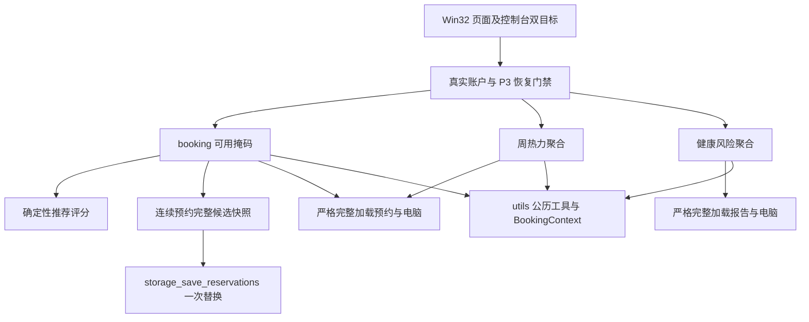

# P6 智能预约与实验室分析设计

基线：`0ca300d`（P0–P5.4）。纯 C11、Win32/GDI、单进程 TXT 快照。按 P6.0→P6.1→P6.2→P6.3→P6.4 顺序独立验收、提交及正常推送；某阶段失败先修复，不进入下阶段。本文是实现契约，实测结果另归档，不能用设计推定通过。

## 公共依赖与边界

已阅读 model、booking、fault、stats、storage、utils、admin 及 GUI 页面/公共组件、P5.4 验收、演示指南、README、PowerShell/Make 构建与分析脚本。

日期统一使用 `utils_valid_date/date_serial/date_add/slot_future`；时间使用 `BookingContext`，正式调用 NULL 读取本地时钟。新增业务入口复用 `fault_require_role` 验证真实账户和 P3 恢复门禁，底层严格加载失败不得发布部分输出。无权限、账户缺失、存储损坏/I/O、内存、容量、恢复未完成、时钟、非法日期/时段各自保留真实结果。推荐与连续预约复用 booking 时间窗口和公共可用性快照；不能对每台电脑读一遍预约文件。

新增结果仅为内存投影，不改 model 中的持久结构，不新增数据文件。原账户、Reservation、FaultReport、count.txt、维护日志及恢复流程兼容。只读功能不调用保存、初始化或恢复；WM_PAINT 只读取缓存，不加载或排序。数据读取严格验证 O(N log N) 的成本需与聚合自身 O(N) 区分。

## P6.1 推荐

目标：学生输入日期、起始时段、1–3 小时、偏好，获得最多前三个可解释候选，结果本身不预约。输入来自认证会话和控件；数据来自完整验证的电脑表、预约表及本地时钟。

公共 `booking_availability` 一次加载电脑和预约，生成 40 个低九位 `unsigned int` 可用掩码、当日每机有效预约量、本人冲突掩码。先清故障、座位占用、本人冲突、已开始、超窗口日期的位。请求掩码 `((1u << duration)-1u) << start`，duration 限 1–3，start+duration≤9；跨17点拒绝。候选必须覆盖全部请求位。

评分采用整数基点，避免浮点排序差异。C=包含请求的最大连续可用段长度×10000/9；P=(4-(no-1)/8)×2500，前排为1–8；L=(9-当日有效预约数)×10000/9。三项范围0–100分，保留百分之一分。三种权重（C/P/L）：连续优先70/15/15，靠前优先20/70/10，负载均衡20/10/70。总分=(C×Wc+P×Wp+L×Wl)/100，权重和100%。降序总分，同分编号升序；无随机数。负载只是偏好，不推断设备寿命。

接口：`booking_availability`、`recommend_seats`；成功输出固定40台快照/最多3项评分、分项与连续段长度。无候选是合法空结果，本人请求冲突返回具体冲突结果。刷新不占编号、不写文件；点击推荐切到原座位图并高亮；确认仍调用原业务重新检查。GUI 座位页增加“智能推荐”，独立页面复用日期、组合框、原生按钮和蓝灰卡片，避免挤压40席原布局。

聚合 O(N+40×9)，排序 O(40 log40)，加载/验证总 O(N logN)，额外分析空间 O(40)，来源集合和验证索引 O(N)。

## P6.2 周热力图

目标：学生/管理员查看任意日期所在完整周的7×9预约事实，无预测。输入会话、周内日期；输出周一至周日日期、每格有效预约数及数量/40×100%。来源只用 reservations.txt，取消不计；当前电脑故障不改变历史分母40。

接口 `heatmap_compute`：复用P4聚合实现，新增明确允许学生/管理员的纯聚合入口；原日报/周报仍仅管理员。统一日期工具定位周一，支持跨月年闰日，超1000–9999完整周边界拒绝。一次严格加载、一轮聚合，不调用63次日报；与P4同样只计BOOKING_ACTIVE。

颜色按预约数精确定义：[0,8]、[9,16]、[17,24]、[25,32]、[33,40]，对应[0,20%]、(20,40%]等，无重叠；0显示“0”。每格有数字、图例，选择后给日期/时段/数量/两位小数利用率。管理员统计中心和学生座位页提供入口。学生选中未来合法格可导航原座位查询，导航及最终创建均重查P2时间，历史格仍可查看。

聚合 O(N+63)，复用P4最多K=2520项去重索引另需O(K logK)与O(K)；热力投影额外O(63)，严格加载总 O(N logN)/O(N)。不读取或更新 count.txt。

## P6.3 原子连续预约

目标：同机同日连续1–3条一小时预约，全有或全无。输入学生会话、日期、start、duration、no；输出成功后全部Reservation记录/编号。

接口 `booking_check_batch/booking_create_batch`。流程：角色与真实账户→参数/全部时间→电脑→一次完整加载预约→公共掩码和全部座位/本人冲突→剩余容量→最大历史编号≤INT_MAX-duration→扩容→构造连续记录→提交边界复查账户/恢复门禁、电脑、时间和原集合冲突→`storage_save_reservations`一次替换→仅成功发布全部输出。严禁循环调用单条create。提交前检查不重复加载完整预约（单进程、无外部并发写约束）。失败释放候选；原文件不变，可能保留.tmp。保存期间物理时间推进、断电及多进程事务不在保证内。

GUI 复用座位页增加时长，连续模式显示完整覆盖区间，按共同掩码显示可用电脑；推荐选择携带时长。摘要展示电脑、日期、起止、小时数，默认否；成功列出全部编号。提交成功与刷新失败分别显示。个人列表、统计和重启读取自然按原格式增加2/3条；取消仍逐条，不增加组标识。

聚合/构造 O(N+3)，严格验证及保存 O(N logN)，内存 O(N)，一次完整快照提交。

## P6.4 健康分析

目标：管理员从真实报告和当前状态获得透明维护辅助指标，不预测未来故障、不自动维修/改状态/取消。输入管理员会话和当前日期；输出40台当前状态、分数、等级、近7/8–30/更早报告数、未处理数及扣分构成；不返回学生标识或报告描述。

接口 `health_compute`。一次加载电脑/完整报告，一轮聚合。日龄=今天日序-报告日序，未来报告拒绝生成可信分析。窗口日龄0–6（今天及前6天，最近7个自然日）、7–29（第8至30天）、≥30；互斥。初始100：每条报告只取一个扣分额度：近7天8分，第8–30天3分，更早1分；未处理该条再加4分，仍作为该报告一次总扣分；同机总报告数超过1的后续报告各加2分（重复因素）。当前故障另扣65分，因此分数≤35，UI明确“已知故障”事实。累计上限100，最终max(0,100-扣分)，系数集中定义。显示完整分项以解释相加关系，未处理/重复是同一报告的修饰因子，不重复归入时间窗口。

等级85–100健康，65–84关注，40–64建议检查，0–39高风险。升序分数，同分编号升序。规则提示：已知故障、未处理≥2、近30天≥2；无报告正常显示“暂无故障记录”，不能断言硬件完全健康。GUI工作台增加入口，表格40台、四等级数量、选中显示构成。可选跳转已有报告页按电脑筛选；报告明细仍由管理员业务接口验证权限。

聚合 O(R+40)，排序 O(40 log40)，额外 O(40)，严格加载总 O(R logR)/O(R)。

## 文件结构与 GUI 约束

- `include/booking.h`、`src/booking.c`：共同范围掩码、权限/时间/可用投影；维持旧测试独立链接边界，不新增booking外部链接依赖。
- `include/recommend.h`、`src/recommend.c`：推荐与权重。
- `include/heatmap.h`、`src/heatmap.c`：周聚合与颜色级。
- `include/health.h`、`src/health.c`：健康规则与分析。
- booking.h/c：连续预约API，持久格式保持。
- `src/gui/gui_recommend.c`、`gui_heatmap.c`、`gui_health.c`及相应头：正式原生页面，接入现有分发与控件生命周期。
- `tests/test_p6_*.py`、独立C probe及四份阶段验收文档；结果只归档脱敏文本；截图本地docs/screenshots/p6/忽略。

继续原字体、DPI布局、蓝色主色、浅灰背景、白卡片。最小1000×650逻辑客户区不重叠。新页面不依赖原有枚举数值连续性绕过权限；新消息入口角色验证，离页清投影。构建通配源自动纳入，测试链接按所需源更新但不弱化旧断言。

## 测试与独立验收矩阵

|阶段|算法与边界|错误/持久化|GUI及兼容|
|---|---|---|---|
|P6.0|基线1352项逐套重跑|真实data哈希/mtime保护|严格双目标、27个源静态分析；失败如实留档|
|P6.1|逐位掩码、精确分项/总分/排序、三偏好不同、确定性、取消/故障/本人冲突、17点/窗口/跨年|坏文件、无权限、内存、门禁、刷新只读、过时推荐最终拒绝|真实WM_COMMAND/日期/组合框、前三项点击高亮；100/125/150%布局与截图、GDI/USER压力|
|P6.2|全部63格逐项比对P4、0/40/颜色边界、跨月年闰日|取消忽略、故障不改历史、只读、坏文件/权限/门禁|双角色入口、精确数字、合法导航/过期拒绝、DPI/资源/截图|
|P6.3|2/3小时完整记录、任一冲突整组失败、容量、INT_MAX、时钟推进|写/刷新/关闭/替换失败原快照不变、输出不变、重启、单条取消|真实确认/放弃、完整摘要/编号、刷新失败独立、列表/统计增量、DPI/截图/资源|
|P6.4|精确扣分、7/30天边界、未处理/重复、0–100、等级边界、稳定排序|未来日期/坏文件拒绝、只读、门禁、学生不可读明细|40台表格、汇总/构成、筛选报告、DPI/截图/资源|

每阶段严格C11、GCC -fanalyzer、原1352回归和本阶段全部新测试通过，更新README/测试索引后以指定提交消息提交推送origin/main。保留失败证据，不修改旧测试掩盖回归。GUI自动化布局、模拟DPI、真实系统DPI和实际截图目视分别记录，不混称通过；未验证项显式列出。

最终P6.4后新增 `P6_INNOVATION_FINAL_REPORT.md`，含公式、结构/API、Mermaid流程图、复杂度、真实输入输出、测试计数、GUI映射、题目对应、限制和答辩要点，并更新DEMO_GUIDE。
