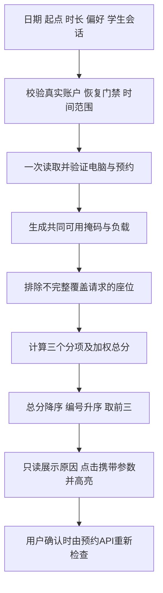
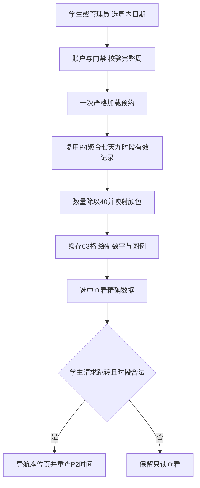
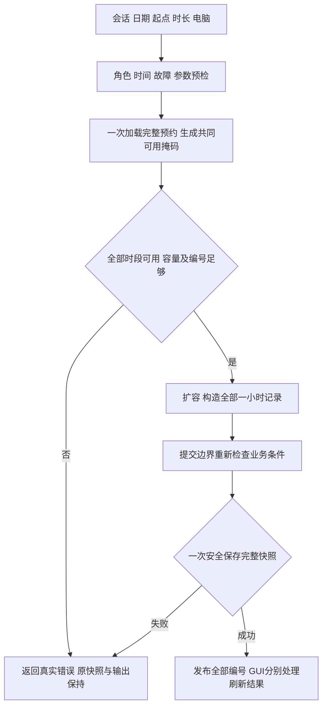
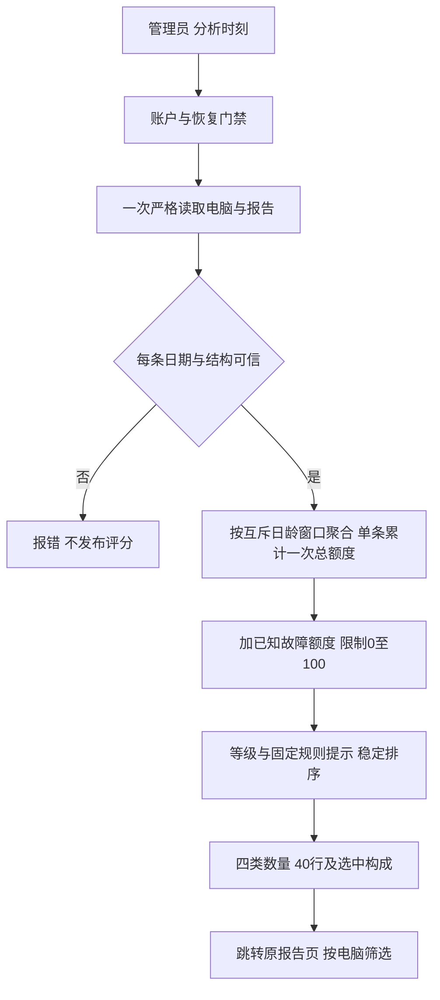

# P6 智能预约与实验室分析最终报告

## 交付与验证结论

基于 `0ca300d` 的纯 C11、Win32/GDI、TXT 单进程系统，按 P6.0→P6.4 顺序完成设计、智能推荐、周预约热力图、原子连续预约和设备健康分析。全部页面使用真实业务数据；没有外部 AI API、数据库、网络服务或预测模型。原控制台与 GUI 双目标、文件格式、P3 恢复机制及原有业务保留。

2026-10-19 最终执行 `powershell -NoProfile -ExecutionPolicy Bypass -File .\build.ps1 -Analyze -Test -GuiTest`，进程退出码 0。双目标通过 `-std=c11 -Wall -Wextra -Wpedantic -Werror`，33 个生产 C 文件通过 GCC 静态分析；**1950/1950 项通过**。这是逐套实际结果的合计，不包含编译次数、截图数量或重复运行次数。证据见 [完整日志](../tests/results/p6-4-final-regression.log)、[分阶段设计](P6_INNOVATION_DESIGN.md) 和四份验收记录。

|套件|通过数|
|---|---:|
|P0 / P1 / P2 / P3 / P4|57 / 134 / 155 / 119 / 112|
|原 GUI 基础 / 学生 / 管理员 / 最终优化|93 / 263 / 359 / 60|
|P6.1 推荐 / P6.2 热力图 / P6.3 连续预约 / P6.4 健康|128 / 115 / 189 / 166|
|原功能合计 / 新增合计 / 最终合计|1352 / 598 / 1950|

阶段完整验收依次为 1352、1480、1595、1784、1950 项；各阶段通过后独立提交、正常推送。对应提交标题依次为 `docs: design P6 innovation modules`、`feat: add intelligent seat recommendations`、`feat: add laboratory booking heatmap`、`feat: add atomic multi-slot reservations`、`feat: add computer health scoring`。本报告随最后一阶段归档。

## 1. 可解释的智能座位推荐

价值：学生给出日期、起点、1–3 小时及偏好后，先得到能覆盖整个请求的候选，再比较连续空闲、位置和当日预约负载。推荐减少逐座查询，不直接创建记录，也不代表座位被保留。

`BookingAvailability` 保存 40 台设备的低九位可用掩码、当日有效预约量、真实状态、本人冲突掩码和取样时刻。第 0 位代表 08:00–09:00，第 8 位代表 16:00–17:00。统一 `booking_range_mask(start,duration)` 拒绝时长非法或越过 17:00；合法请求为 `((1u << duration)-1u) << start`。一次读取严格验证后的电脑与预约表，清除故障、占位、本人冲突及已开始时段。候选必须满足 `(available & request)==request`，不能靠低分保留不合法座位。

`SeatRecommendation` 保存编号、总分、三个分项和连续段长度；`Recommendation` 最多三项。`recommend_seats` 只读，返回具体业务错误或确定性候选。令 r 为包含请求的最长连续可用段长度、row=(编号−1)/8、load 为当日有效预约量，内部用整数基点：

```text
C = floor(r × 10000 / 9)
P = (4 − row) × 2500
L = floor((9 − load) × 10000 / 9)
S = floor((Wc × C + Wp × P + Wl × L) / 100)
显示分数 = 内部整数 / 100
```

|偏好|Wc|Wp|Wl|
|---|---:|---:|---:|
|连续可用优先|70|15|15|
|靠前优先|20|70|10|
|负载均衡|20|10|70|

权重和 100%，各分项均为 0–100 分。按总分降序、编号升序，无随机数。负载仅为选择偏好，不推断设备寿命。空预约、全部正常、明日 08:00 起两小时，三种偏好均可得到 1、2、3 号，每项 100.00 分；空表时切换偏好并不必然换排序。测试另构造真实占用差异，逐项核对不同权重后的排序、分数和原因。



验收见 [P6.1](../tests/P6_1_RECOMMENDATION_TEST_CASES.md)：128 项包含精确输出、权重差异、掩码逐位、取消/故障/本人冲突、日期和闭馆边界、过时推荐最终拒绝、内存与只读保护、原生控件点击及资源循环。

## 2. 一周预约热力图

价值：学生和管理员共用 7×9 的预约事实视图，快速比较不同日期与时段。`BookingHeatmap` 包含七天日期和 63 个 `HeatCell {count,utilization}`。`heatmap_compute` 通过明确允许两种角色的 `stats_compute_heatmap` 复用 P4 周聚合；原日报/周报接口仍只允许管理员。`utils_week_start` 统一公历周一定位，完整周超出支持年份时拒绝。

只统计有效预约，取消不计；利用率=count/40×100%，固定理论容量，不以当前故障状态改写历史。一次加载、一轮聚合，无 63 次重复文件读取。`count.txt` 是显式导出快照，热图直接读取预约事实，不依赖或更新该文件。

颜色按数量分成 [0,8]、[9,16]、[17,24]、[25,32]、[33,40] 五档，对应 [0,20%]、(20%,40%]、(40%,60%]、(60%,80%]、(80%,100%]。格内始终有数字，选中显示具体日期、时段、N/40 和两位小数。例如周二 10:00–11:00 有 31 条有效记录，结果为 31/40、77.50%、第四档；取消其中一条则为 30/40、75.00%。当前故障变化本身不重写过去数量。



验收见 [P6.2](../tests/P6_2_HEATMAP_TEST_CASES.md)：115 项逐格比对 P4、颜色端点、空周、满时段、跨月/年/闰日、取消/历史故障、双角色、合法跳转、只读和 GUI 资源。自绘网格用单一原生子窗口绘制 63 格，支持鼠标/键盘选格。

## 3. 全有或全无的连续预约

价值：一次确认同机同日连续 1–3 小时，任意一小时失败则整次失败。仍保存为原六字段的一小时 `Reservation`，个人列表、统计和取消规则自然兼容。

`BatchBooking` 为 `Reservation records[3]` 和实际条数。`booking_check_batch` 用于预检，`booking_create_batch` 完成提交。两者复用共同可用掩码，逐项检查学生和座位冲突。创建只加载一次完整预约集合，检查 `MAX_RESERVATIONS` 剩余容量及历史最大编号能否分配 duration 个新编号；不复用取消记录编号。内存中构造完整候选，提交边界再次复核账户、P3 门禁、电脑状态、当前时刻和原集合条件，然后仅调用一次 `storage_save_reservations()`。成功替换快照后才发布全部结果；失败输出保持、原快照保留。

不能用循环调用单条创建替代。重新检查使用已加载的原集合视图，基于单进程且无外部写入的现有约束；不承诺多进程数据库事务或物理断电耐久。



示例：空表，明日、2 号电脑、10:00 起两小时，得到编号 1/2，分别保存 slot=2/3 的 10–11 与 11–12 记录；统计增加两条。若后一小时已被占用则两条都不增加。取消编号 1 后编号 2 保持。达到 INT_MAX 或剩余容量不足时安全拒绝。

GUI 蓝色摘要显示整个覆盖区间，时长组合框控制候选；推荐点击携带时长。确认默认“否”，摘要含电脑、日期、起止和小时数；成功展示全部编号。保存成功但刷新失败有单独提示，不误报保存失败并诱导重复提交。验收见 [P6.3](../tests/P6_3_BATCH_BOOKING_TEST_CASES.md)：189 项覆盖 2/3 小时、每个冲突位置、容量 100000、INT_MAX、提交时钟推进、每次分配失败、实际 Windows 替换锁、写/刷新/关闭故障、单次加载/保存计数、重启及单条取消。

## 4. 设备健康评分与维护建议

价值：管理员从当前状态和已有报告识别优先检查对象。该分数是透明启发式维护指标，不是硬件检测或未来故障概率。

`DeviceHealth` 保留真实电脑状态、分数、等级、三个互斥日龄窗口计数、未处理数、总报告数、报告总扣分、故障扣分、重复修饰及预警位；`HealthSummary` 保存 40 台排序结果、四类数量和分析时刻。`health_compute` 只允许真实管理员，一次读取电脑和完整报告，未来日期或坏文件拒绝整个结果。返回投影不含学号、姓名和报告说明。

令 a 为今天与报告日期的公历日龄。常数集中于 `health.h`：

```text
base(a) = 8 (0≤a≤6), 3 (7≤a≤29), 1 (a≥30)
单机报告总额度 = Σbase(a) + 4×未处理数 + 2×max(总报告数−1,0)
已知故障额度 = 当前故障 ? 65 : 0
score = max(0,100−报告总额度−已知故障额度)
```

每条唯一报告只累加一次总贡献，包含时间基础额度、未处理修饰和后续重复修饰；时间窗口不重叠，重复合计与文件顺序无关。重复修饰已包含在报告总额度内，显示分项时不能再减第二遍。等级为 85–100 健康、65–84 关注、40–64 建议检查、0–39 高风险。按分数升序、同分编号升序。

固定提示：当前故障显示“已知”；未处理≥2 提醒关注；近 30 天报告≥2 提醒检查。当前正常且零报告为 100，文字仅称“暂无故障记录”。分析不自动维修、改状态或取消预约；管理员进入原维护流程并确认后才发生这些操作。



精确样例：1 号正常，报告日龄 0/6/7/29/30/70，其中 0 和 7 未处理，则窗口 2/2/2、未处理 2、总报告 6；时间基础 24、未处理修饰 8、重复修饰 10，报告额度 42，得分 **58**、建议检查。2 号已知故障且无报告，得分 **35**、高风险。20 条当日报告均已处理，得分截断为 0。10000 条已处理当日报告，报告额度 99998、其中重复 19998，测试逐项比对。

真实 GUI 串联的另一组新目录数据只有一条当日待处理报告：正常 **88**；通过原报告确认故障且关闭该报告后 **27**，未来两条预约按 P3 取消；通过原维护流程恢复正常后 **92**，历史报告保留，取消预约不复活。这些数值有明确数据前提，不可套用静态六报告样例。

验收见 [P6.4](../tests/P6_4_HEALTH_SCORE_TEST_CASES.md)：166 项含独立 Python 公式对照全部 40 台字段和排序、所有等级边界、日龄 0/6/7/29/30、闰日跨年、10000/10001 报告、逐次分配失败、真实读取锁、权限及只读校验、40 行虚拟表、相关报告筛选、资源循环和四功能完整串联。

## 5. 公共结构、复杂度及页面映射

N≤100000 为预约数，R≤10000 为报告数，K≤2520 为周内有效预约数。严格加载包含排序索引校验，不能把扫描复杂度直接当成完整接口复杂度。

|功能|聚合及排序|包含严格加载/保存的总时间|总额外空间|
|---|---|---|---|
|推荐|O(N+40×9+40log40)|O(NlogN)|O(N)，投影 O(40)|
|热力图|O(N+63+KlogK)，沿用P4去重|O(NlogN+KlogK)|O(N+K)，热图 O(63)|
|连续预约|O(N+3)，提交复查与构造|O(NlogN)，含完整安全保存校验|O(N)|
|健康分析|O(R+40log40)|O(RlogR)|O(R)，投影 O(40)|

|原生页面/操作|业务接口|文件行为|
|---|---|---|
|学生座位→智能推荐→结果点击|`recommend_seats` / `booking_availability`|只读；导航与高亮|
|学生座位、管理员统计→预约热力图|`heatmap_compute` / `stats_compute_heatmap`|只读；学生跳转仍重查时间|
|学生座位→时长→确认|`booking_check_batch` / `booking_create_batch`；一小时保留原单条入口|一次成功快照保存|
|管理员工作台→设备健康分析|`health_compute`|只读设备统计|
|健康选中设备→查看相关报告|原管理员报告查询/处理接口|查看只读；原维护动作需另行确认|

共用 booking 的可用性与公历日期工具，避免推荐/连续预约重复定义冲突。保留结果枚举语义，新增维护未完成结果不挪动旧值；GUI 使用真实业务错误。账户校验、坏文件、时钟错误、容量、分配失败、P3 门禁等均不能伪装成空结果。旧账户加载接口返回布尔值，部分账户读取内存失败仍归入其原有通用存储错误；没有改造旧格式或虚报更细错误精度。

GUI 缓存只在进入、刷新、筛选和业务完成后生成；WM_PAINT、虚拟表文本回调不读取文件或排序。页面离开/注销释放集合并清投影，继续使用蓝色主色、白卡片、浅灰背景、原生按钮/表格和既有 DPI 布局。

## 6. 原题对应、真实演示与验收边界

|原题及本次要求|实现对应|
|---|---|
|40台电脑、08–17九时段、学生/管理员|固定容量与两层权限校验；四功能接入原角色页面|
|预约冲突、故障禁约、取消与个人查询|共同掩码、最终重查、原一小时记录/取消规则|
|error.txt、count.txt、日报周报|报告源复用；热图与P4同口径；查询无隐式导出|
|故障处理和中断恢复|健康分析只建议；原P3维护操作及门禁保持|
|创新算法可解释与可验证|公开权重/公式/端点、确定性排序、独立精确输出预期|
|连续预约真正原子提交|单个完整预约快照一次替换，保存失败不部分成功|
|纯C11及原生GUI|双目标严格编译，33个源静态分析，未加入其他GUI框架|

实际窗口已运行并保存五张本地合成数据截图：推荐、热力图、三小时区间、健康最小窗口和健康普通窗口，位于 `docs/screenshots/p6/`（Git 忽略）。健康最小窗口实际 1000×650、普通 1280×800，已查看卡片、六列、表格及构成，未见控件重叠或布局裁切。截图不作为算法正确性的唯一依据。

最终套件还在全新隔离目录通过真实注册/登录与生产窗口原生消息完成：推荐两小时→选座确认→两个真实编号→两格各 2.50%→真实报障→88分→报告筛选→确认故障→27分及取消→热图归零→恢复92分且不复活。它使用真实时钟、文件和确认框；不称为人工全程鼠标键盘演示。该串联已知故障页面的独立截图因窗口遮挡未取得，没有保存遮挡画面作为证据。可按 [演示指南](DEMO_GUIDE.md) 用明日日期重演。

本轮新页面测试含 96/120/144 消息 DPI 的最小/正常布局和资源循环；旧最终 GUI 套件还在实际系统 DPI 144 下完成其既有检查。本轮未切换 Windows 实际缩放验证全部新页的 100%/125%/150%；模拟消息不能代替真实系统缩放验收。截图小字笔画采集失真沿用旧验收已记录的限制，不宣称中文字体清晰度全部通过。多显示器、真实输入法组合和全部新页多实际缩放人工检查仍未覆盖。

首次 P6.0 学生 GUI 有 16 项失败，未改源码/断言的独立复跑 263 项通过，原因未确定；保留原始证据。新增控件使旧基础测试的精确子控件数量必须随正式功能从50更新到53，并增加推荐/热图/时长控件存在断言，未删除旧业务断言。热图资源测试先预热和完整泵消息，再执行原阈值循环；健康测试器先后修复排他锁快照时机和默认GBK解码问题，未用修改业务规则来获得通过。各阶段详情见对应验收与日志。

所有测试使用 `tests/runs/` 新目录，并核对项目 data 原字节/修改时间；没有清空真实数据或批量删除文件。Git 只归档脱敏文本、源码与测试脚本，不含账户原文、密码、可执行文件、临时快照或截图。只读新功能核对业务文件哈希/mtime不变。

其他限制：当前为单进程且无外部并发写入；完整快照不是多进程事务或断电耐久保证；数据读取同步执行，大规模分析可能有等待；没有签到、硬件传感器和完整维修时间轴，预约利用率不代表实际使用率；健康分不预测未来；连续取消仍逐条，无预约组标识；未验证其他操作系统、其他工具链、真实磁盘耗尽与物理断电。

## 7. 可用于课程设计报告的创新说明

本系统在既有文件型实验室预约系统上，引入可解释的多因素座位推荐、周时空预约可视化、连续时段原子预约和设备维护辅助评分。推荐算法先以九位掩码统一处理合法性，再按公开权重排序，使选择依据可复算；热力图复用统计事实，以固定容量和精确数量展示繁忙程度；连续预约将多个一小时记录作为完整快照一次提交，避免逐条保存造成部分成功；健康分析通过互斥时间窗口与公开规则汇总故障报告，区分已知状态与辅助建议。四项功能均与原有权限、存储校验和恢复机制结合，并通过精确算法预期、异常注入和原生 GUI 集成测试验证。

## 8. 答辩讲解要点

- 推荐：先展示输入与三个权重，再解释掩码先排除不可用、评分只比较合法候选。同分按编号，点击仅选座，最终确认重新校验。现场空数据可能不因改偏好而换前三名。
- 热力图：说明横轴七天、纵轴九时段、固定40分母；点击格子读精确数，创建/取消后刷新验证变化。历史数量不因当前故障重算，不称实际使用率。
- 连续预约：演示两小时产生两条原格式记录，再解释一次保存与循环创建的差别。指出任一小时冲突整组拒绝、编号和容量检查、单条取消与单进程边界。
- 健康：从报告日期/状态和当前设备状态手算一例，讲清互斥窗口及修饰因素只计一次；展示已知故障标签、相关报告跳转、无报告说明。分析本身不改设备、不取消预约，不宣称预测。

完整现场顺序与样例前提见 [DEMO_GUIDE](DEMO_GUIDE.md)。正式 Word 课程设计报告不在本次交付范围内。
